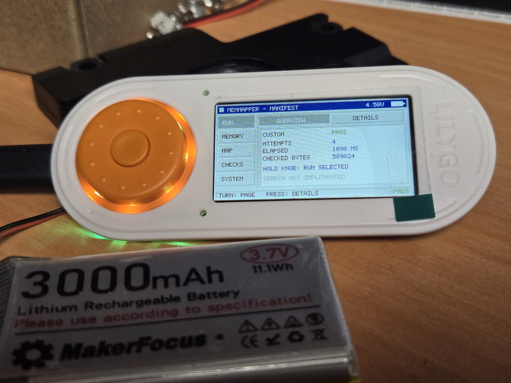

# ESP4GW


**ESP4GW is a native DOS-era compatibility layer and `<dos.h>` hardware abstraction layer for Espressif ESP32 microcontrollers.**

Its goal is to make it easier to port source code originally written for DOS, Watcom C/C++, DOS/4GW, and similar protected-mode environments to modern ESP32 hardware without first rewriting every DOS-facing part of the program.

ESP4GW does **not** run DOS.

ESP4GW does **not** emulate a PC.

ESP4GW does **not** execute DOS binaries.

Instead, legacy source code is recompiled natively for the ESP32, while ESP4GW provides compatible interfaces for the DOS-era services that the source expects.

**Status: experimental / early development.** Native filesystem/runtime support, shared keyboard services, and an optional profile-backed memory service exist today. The SeaBIOS-derived vBIOS now includes an adapted E820 memory-map unit, named-resource and ISO installation work, and an emerging clock/timer boundary. The broader BIOS and timer integration remains unfinished. DPMI, managed swap, and the proposed P4 memory layout are development direction, not released capabilities.

The native keyboard backend supports the ESP32 BLE Keyboard and onscreen input.
See [keyboard integration and supported services](doc/keyboard-compatibility.md),
[validation and resource measurements](doc/keyboard-validation.md), and the
[standalone receiver example](examples/keyboard/README.md).

[Memmapper](#memmapper) now exercises memory profiles on a host or ESP32-S3,
with a working T-Embed inspection UI, custom-profile editor, SD records, and
a first in-boot candidate sweep. See its dedicated section below.

## Reading this README

- [Purpose](#the-idea) and [project boundaries](#what-esp4gw-is-not)
- [Current status](#current-status)
- [Architecture and call boundaries](#architecture-and-call-boundaries)
- [The native vBIOS and SeaBIOS foundation](#the-native-vbios-and-seabios-foundation)
- [New vBIOS units](#new-vbios-units)
- [Clocks, timers, and chip choices](#clocks-timers-and-chip-choices)
- [Devices and bidirectional services](#devices-and-bidirectional-services)
- [Interrupts and callbacks](#interrupts-and-callbacks)
- [Memory and address contracts](#memory-and-address-contracts)
- [Memmapper](#memmapper)
- [DPMI foundation](#dpmi-foundation)
- [Virtual memory and swap](#virtual-memory)
- [Target platforms and P4 memory budgets](#target-platforms)
- [Integration, validation, and development direction](#integration-and-validation)

---

## The Idea

A typical DOS game or application from the early-to-mid 1990s may contain perfectly portable game, application, file-format, math, rendering, or simulation code surrounded by assumptions such as:

```c
#include <dos.h>
#include <conio.h>
#include <i86.h>

_dos_findfirst(...);
_dos_open(...);
_dos_read(...);

int86(...);
intdos(...);

inp(...);
outp(...);
```

On a modern embedded target, the useful code may still compile cleanly once those platform dependencies are resolved.

ESP4GW exists to provide that resolution layer.

Instead of forcing every port to replace DOS APIs individually:

```text
Legacy Application Source
          |
          v
       ESP4GW
          |
          +---- Filesystem
          +---- Memory
          +---- Timers
          +---- Input
          +---- Display
          +---- Audio
          +---- DOS compatibility services
          +---- DPMI-inspired services
          |
          v
       ESP-IDF
          |
          v
        ESP32
```

The application remains recognizable as the original source.

The machine underneath it does not.

---

## What ESP4GW Is

ESP4GW is intended to become a reusable compatibility layer for **native source ports** of DOS-era software.

The project aims to provide familiar interfaces used by DOS applications while translating those operations into appropriate ESP32 and ESP-IDF facilities.

Where practical, legacy source should be able to retain calls such as:

```c
_dos_findfirst()
_dos_findnext()

_dos_open()
_dos_close()
_dos_read()
_dos_write()

_dos_getdate()
_dos_gettime()

int86()
intdos()
```

without each application having to invent its own incompatible replacement.

ESP4GW is therefore best thought of as:

> **A DOS programming environment personality for native ESP32 applications.**

It preserves useful interfaces and semantics.

It does not preserve the original machine.

---

## What ESP4GW Intends To Be

ESP4GW is intended to grow into several related compatibility layers.

### DOS C Runtime Compatibility

Provide commonly encountered DOS and Watcom-style structures, constants, functions, and headers.

Examples include:

```text
dos.h
conio.h
i86.h
io.h
direct.h
```

Only interfaces useful to real source ports need to be implemented.

The goal is practical compatibility, not archaeological completeness.

### DOS Service Translation

DOS filesystem and operating-environment requests can be translated into ESP-IDF, VFS, FATFS, POSIX, FreeRTOS, or other native facilities.

For example:

```text
DOS file search     -> ESP filesystem directory enumeration
DOS file handles    -> native file descriptors
DOS date/time       -> ESP/native time services
DOS disk queries    -> mounted filesystem information
```

The caller sees the familiar interface.

ESP4GW performs the translation.

### DPMI-Inspired Compatibility

DOS/4GW applications commonly lived in a DPMI protected-mode environment.

ESP4GW may eventually provide compatible abstractions for useful portions of that environment, including areas such as:

- memory allocation
- large-memory management
- memory locking
- virtual memory
- descriptor-like objects
- callback and vector registration
- interrupt-style service dispatch
- legacy register structures
- DOS service requests

These services will be implemented in terms appropriate to the ESP32.

An ESP32 does not have an x86 Global Descriptor Table simply because a legacy source file refers to selectors.

Where the underlying architecture differs, ESP4GW will translate the **meaning** of the operation rather than attempting to recreate unnecessary x86 machinery.

### Hardware Abstraction

Some legacy programs communicate with hardware through mechanisms such as:

```c
inp()
outp()
```

or through BIOS/DOS interrupt interfaces.

Where useful, ESP4GW may provide translation layers for commonly encountered DOS-era hardware concepts.

Potential examples include:

```text
VGA palette operations
timers
keyboard input
mouse input
joystick input
audio devices
storage devices
```

This does not mean ESP4GW will emulate those devices.

A request associated with an old PC device may instead be translated into the native ESP32 subsystem serving the same purpose.

### Porting Diagnostics

Unsupported operations should fail visibly and honestly.

A compatibility layer that silently pretends something worked is considerably more dangerous than one that says:

```text
ESP4GW: unsupported service
ESP4GW: unsupported interrupt
ESP4GW: unsupported I/O port
```

One long-term goal is for ESP4GW to help identify the remaining architecture-specific assumptions inside a legacy application.

In that role it becomes both a compatibility library and a porting tool.

---

## What ESP4GW Is NOT

The boundaries of this project are deliberate.

They are not temporary limitations waiting to become features.

### ESP4GW Is Not An Operating System

ESP4GW will **never become an operating system**.

It does not boot hardware into DOS.

It does not provide a DOS command shell.

It does not provide `COMMAND.COM`.

It does not attempt to replace FreeDOS, MS-DOS, DR-DOS, or any other operating system.

ESP-IDF and the underlying ESP32 runtime remain responsible for the actual system.

ESP4GW is a library used by an application running inside that environment.

---

### ESP4GW Is Not An Emulator

ESP4GW will **never become a PC emulator or x86 emulator**.

It will not emulate:

- an 8086
- an 80286
- an 80386
- an 80486
- x86 protected mode
- an IBM-compatible PC
- a bootable PC BIOS or its firmware execution environment
- DOS as a machine environment

There is no virtual x86 CPU executing instructions.

There is no cycle-by-cycle recreation of PC hardware.

There is no intention to turn ESP4GW into DOSBox.

---

### ESP4GW Does Not Run DOS Executables

ESP4GW does not load and execute:

```text
.EXE
.COM
LE/LX
DOS/4GW binaries
Watcom executables
```

Programs must be available as source code and compiled for the target ESP32 architecture.

For example:

```text
Original:

DOS source
    |
Watcom C/C++
    |
DOS/4GW
    |
80386

ESP4GW:

DOS source
    |
ESP-compatible compiler
    |
ESP4GW
    |
ESP-IDF
    |
ESP32
```

ESP4GW targets **source compatibility**, not binary compatibility.

---

### ESP4GW Is Not DOS/4GW Ported To Another CPU

Despite the name, ESP4GW is not intended to be a literal architecture port of the original DOS/4GW executable.

DOS/4GW contains machinery specifically designed around x86 protected mode, DOS, BIOS services, descriptors, interrupts, and 386-class CPUs.

Recreating all of that machinery on another architecture would provide little benefit to a native source port.

ESP4GW instead asks:

> What service was the application trying to obtain from DOS/4GW?

That service can then be implemented natively.

The interface may survive.

The implementation does not have to.

---

### ESP4GW Is Not A Compatibility Excuse

ESP4GW will not claim that unsupported behavior works when it does not.

Some DOS concepts do not have useful equivalents on ESP32.

Some can be translated.

Some can be represented by lightweight compatibility objects.

Some require application changes.

Some should simply return:

```text
DOS_ERR_NOT_SUPPORTED
```

That distinction is intentional.

Correct failure is preferable to fake compatibility.

---

## Compatibility Philosophy

ESP4GW follows several basic rules.

### Preserve source when practical

If a DOS-era interface can be supported cleanly, keep the interface.

Avoid forcing application-specific rewrites for problems that can be solved once inside ESP4GW.

### Translate semantics, not architecture

A DOS API requesting a directory search does not require DOS.

It requires a directory search.

A timer interrupt may not require an x86 interrupt.

It may require a periodic callback.

A protected-mode memory allocation does not necessarily require an x86 descriptor.

It requires memory with the expected lifetime and behavior.

ESP4GW attempts to preserve the useful semantic contract.

### Never fake success

If ESP4GW cannot perform an operation correctly, it should report that fact.

### Avoid application-specific hacks

ESP4GW is intended to become reusable infrastructure.

Application-specific workarounds belong in the application unless they represent a generally useful DOS compatibility behavior.

### Native first

The resulting application should remain an ESP32 application.

ESP-IDF, FreeRTOS, native peripherals, PSRAM, flash, SD storage, native display controllers, Bluetooth, USB, and other ESP facilities should be usable directly.

ESP4GW should help legacy code join that environment rather than hiding it behind a simulated PC.

---

## Current Status

ESP4GW is at a very early stage.

The initial `<dos.h>` compatibility layer already defines a number of classic DOS-facing data structures and APIs, including:

```text
REGS
SREGS
DOSERROR
find_t
dosdate_t
dostime_t
diskfree_t
```

as well as a growing collection of `_dos_*`, `int86`, `intdos`, and related interfaces.

The current implementation already provides native ESP32-backed functionality for several filesystem and runtime operations.

Examples include:

- file search
- file open/create/close
- file read/write
- file attributes
- file timestamps
- date and time queries
- filesystem free-space queries
- DOS-style error translation

Unsupported facilities currently report an explicit unsupported result rather than manufacturing DOS behavior.

This is intentional, but the exact error conventions still need work in some paths. The general interrupt fallback currently uses a DOS-style failure result; individual BIOS, mouse, and DPMI operations need their own correct absence/error conventions as support expands.

### Implementation versus direction

| Area | Current state |
|---|---|
| Watcom personality | Active headers and native adapters; some interfaces are implemented, others remain declarations or unsupported stubs. |
| Filesystem/runtime | Native implementations exist, with path, drive-mapping, and filesystem-specific limits. |
| Keyboard | Shared input core, BLE report adapter, onscreen frontend, conio input, BIOS keyboard wrappers, and selected interrupt services. |
| PC speaker tones | Optional shared tone service, Watcom `sound()`/`nosound()` adapters, and a T-Embed I2S backend in memapper. Host/build validation; audible hardware acceptance pending. No direct PIT-port support. |
| General vBIOS | Most imported sources remain outside the root component build; the adapted `memmap.cpp` is built with the optional memory service. |
| Native memory | Checked profile/backing bindings, E820 publication, and a native paragraph allocator exist. Opt-in through `CONFIG_ESP4GW_MEMORY` or the memory-only component mode. |
| Memmapper | T-Embed inspection UI, custom-profile correctness checks, SD session records, and an initial in-boot size/placement sweep. Reboot recovery and qualified production profiles remain planned. |
| ISO and named resources | `iso.cpp/.h` and `romfile.cpp/.h` provide early units; neither is registered in the root component build. |
| Clocks and timers | Imported PIT/RTC behavior and an `esp_timer` callback adapter are present. Native clock ownership, BIOS routing, and chip/backend selection are not integrated. |
| General vectors and interrupt masking | Not implemented as a complete facility; selected keyboard service dispatch is a narrower capability. |
| DOS segmented allocation | `_dos_allocmem`, `_dos_freemem`, and `_dos_setblock` report unsupported. |
| DPMI and swap | Planned; no working DPMI host or transparent paging claim. |
| P4/C6 hardware | Target direction; existing documented firmware validation is on ESP32-S3. |

Declaring an API does not establish its implementation. Likewise, a working `_dos_*` wrapper does not establish that its equivalent INT 21h function is routed through the register dispatcher.

### The keyboard demonstrates the model

The implemented keyboard interfaces share native input state:

```text
BLE reports --------+
                    +--> normalized input and held-state ownership
Onscreen input -----+                     |
                                          +--> BIOS key queue
                                          +--> conio reads
                                          +--> supported interrupt calls
                                          +--> native application event sink
```

The supported surface includes `getch`, `kbhit`, one-byte `ungetch`, `getche` with a supplied echo callback, legacy/enhanced `_bios_keybrd`, INT 16h functions `00h/01h/02h/10h/11h/12h`, and INT 21h functions `07h/0Bh`.

BIOS and conio share one logical legacy consumer. Conio also owns its pending extended-key suffix and pushback. Concurrent reads from multiple application tasks are outside the contract. Public keyboard operations run in task context; event sinks are serialized, must return quickly, and must not reenter keyboard APIs.

Register conventions matter: `intr` can return keyboard readiness through the zero flag in `REGPACK`. The carry field in the current `REGS` interface used by `int386` must not be repurposed as a zero flag. Those records are not interchangeable.

The user has reported working BLE arrow keys and Escape in dESPcent on CrowPanel. Broader scenarios remain hardware acceptance work. The [keyboard service contract](doc/keyboard-compatibility.md) and [validation record](doc/keyboard-validation.md) describe the exact subset, earlier tests/builds, resource accounting, and remaining measurements.

---

## Current `<dos.h>` Direction

ESP4GW's public API follows the familiar DOS-era programming interface while the implementation lives behind the compatibility layer.

For example:

```c
struct find_t file;

if (_dos_findfirst("*.PIG", _A_NORMAL, &file) == 0)
{
    do
    {
        printf("%s\n", file.name);
    }
    while (_dos_findnext(&file) == 0);

    _dos_findclose(&file);
}
```

The calling code looks like DOS source.

The implementation may be backed by ESP-IDF VFS, FATFS, POSIX APIs, or another native service.

That distinction is the core of ESP4GW.

---

## Architecture and Call Boundaries

The intended architecture separates compiler-facing interfaces, service behavior, shared resources, and physical devices:

```text
                    Ported application source
                              |
             Compiler / runtime compatibility interfaces
                              |
                  +-----------+-----------+
                  |           |           |
              DOS services   vBIOS       DPMI
                  |           |           |
                  +-----------+-----------+
                              |
           Address resolution / resources / callback contracts
                              |
                    Shared native services
                              |
               Device backends and ESP-IDF facilities
                              |
                         ESP32 hardware
```

This is the target structure. Existing DOS, keyboard, and profile-backed memory code supplies parts of it; general resource ownership and DPMI layers are still to be established.

### Four ways across the boundary

| Boundary | Examples | Required contract |
|---|---|---|
| Application calls a service | `_dos_read`, `_bios_keybrd`, `int86`, `int386` | Arguments, results, preserved registers, errors, flags, blocking, and side effects. |
| Application accesses hardware-shaped state | `inp`, `outp`, BIOS data, video-memory references | Supported mappings, access widths, ownership, and synchronization. |
| Application installs a handler | Vector setters, timer hooks, DPMI callback registration | Native callable target, execution context, lifetime, chaining, and removal. |
| Native activity calls the application | Key events, timers, transfer completion, disconnect | Scheduling, reentrancy, buffer lifetime, cancellation, and safe return. |

These contracts define what ESP4GW gets called into and what it can call out to. An interrupt-number checklist alone cannot describe them.

### Synchronous service calls

An int86-style request can be an ordinary native function call:

```text
legacy register arguments
        -> compiler-personality adapter
        -> service/function dispatch
        -> native operation
        -> translated results and flags
```

No CPU interrupt is required. Scalar values retain their API meanings; pointer-bearing arguments need explicit resolution. Each service must preserve the fields its interface promises and use the appropriate error convention.

A direct wrapper may call a shared native service without manufacturing a register frame. BIOS, conio, and native application APIs should agree because they share behavior and state, not because every operation takes an identical route.

### Compatibility inventory

For every service, record its public entry point, argument/result layout, shared state, blocking behavior, callback behavior, and required source adaptation. Direct memory references, port accesses, inline assembly, and compiler-specific handler declarations belong beside ordinary calls in this inventory.

Separate implemented behavior, supported adaptations, explicit unsupported behavior, and unexamined assumptions. That inventory becomes the basis for an application's compatibility report and the next implementation priorities.

## The Native vBIOS and SeaBIOS Foundation

SeaBIOS provides a substantial foundation for BIOS service contracts: function decoding, register results, status conventions, data structures, and service organization. ESP4GW is adapting that foundation into native services for ported applications.

Here, **vBIOS means the BIOS-facing service layer inside ESP4GW**. It is not a bootable ROM, a virtual x86 machine, or firmware that starts DOS. The acceptance target is an application's supported operations, not DOS 6.22 surviving a boot.

See the [vBIOS README and FAQ](src/core/bios/README.md) for its scope, hardware ownership, and the role of the imported x86 sources.

The imported files are not a ready-to-build ESP32 BIOS. They still contain x86 assembly, segmented addressing, physical PC addresses, firmware stacks, PC hardware initialization, and real/protected-mode transitions. Those mechanisms require replacement or exclusion from the native build.

### Reusable behavior and native replacements

| Imported source | Intended role |
|---|---|
| `bregs.h` | Internal BIOS request/result representation and flag helpers, adapted to public compiler personalities. |
| `std/bda.h` | Legacy layouts for exposed BIOS compatibility state. |
| `biosvar.h` | Replace physical/segment access with access to native state. |
| `disk.c`, `block.h` | Request decoding, status handling, and a boundary for native disk operations. |
| `clock.c` | Imported BIOS tick/calendar behavior to adapt to native time sources. |
| `output.c`, `output.h` | Useful output and diagnostic behavior after separating firmware dependencies. |
| `farptr.h`, `stacks.h`, `x86.c/.h` | Architecture-specific mechanisms to replace or exclude. |

For example, `handle_1a00` reads the tick count, returns it in `CX:DX`, consumes the rollover indication, and clears carry. That behavior can become a native service. The surrounding setup still initializes PC timers/RTC hardware and interrupt entries; that is a separate adaptation task.

Similarly, `disk.c` packages operations for `send_disk_op`. That is a useful native storage boundary, but the imported code is not already an ESP-IDF storage backend.

### BIOS data must remain coherent

The BIOS Data Area can become a compatibility view of native state. Its historical field layout is useful where source expects BIOS data, but a second keyboard queue or clock state must not silently diverge from the existing shared service.

For every exposed field, define whether it is authoritative storage, a synchronized view, or a read-only report. If application writes are supported, specify how they affect the underlying service. Allocating a packed structure does not establish that behavior by itself.

### Configuration has three purposes

The imported configuration header mixes different kinds of definitions:

| Category | Examples | Treatment |
|---|---|---|
| Native service configuration | Device limits, enabled features, tracing levels | Keep or adapt as actual ESP4GW configuration. |
| Compatibility identity/layout | BIOS identifiers, segment names, legacy table formats | Expose only where meaningful and consistent with supported services. |
| PC firmware machinery | ROM placement, SMM, AP startup, APIC/HPET addresses, PCI windows | Exclude unless a specific compatibility interface needs a representation. |

Changing the application name to ESP4GW does not make the remaining constants native addresses. `BUILD_BIOS_ADDR = 0xf0000` is not a valid basis for dereferencing ESP32 memory. A historical machine identifier also must not advertise hardware or functions that do not exist.

The next service slices should remain small: state access, a synchronous service, and a callback round trip. Keyboard, clock, display, and device status provide practical expansion points. Boot-sector loading, ROM reset vectors, and PC boot discovery are outside the project scope.

### New vBIOS units

The BIOS directory contains units at different stages of adaptation. These are
separate service building blocks, not a requirement to link the imported BIOS
tree as a whole. The [root component source list](CMakeLists.txt) determines what
normal ESP-IDF integration actually includes.

| Unit | Purpose | Current boundary |
|---|---|---|
| [memmap.cpp/.h](src/core/bios/memmap.h) | Publish and enumerate a supplied compatibility memory map using base 20-byte E820 records. | Included with the optional native memory service. Describes ranges; does not allocate RAM or implement INT 15h dispatch. |
| [memory.cpp](src/memory/memory.cpp) and [public memory API](include/esp4gw/memory.h) | Bind those ranges to caller-owned native storage, check accesses, and allocate conventional-memory paragraphs. | Native implementation with host tests and an S3 correctness fixture; Watcom allocation and DPMI adapters remain pending. |
| [iso.cpp/.h](src/core/bios/iso.h) | Find a requested file set in an ISO9660 image and stage, verify, validate, and promote an installation. | Early `esp4gw::vbios.cdrom` facade adapted from dESPcent/ROTT work; not in the root component build. Not MSCDEX, a mounted DOS filesystem, or a physical optical-drive driver. |
| [romfile.cpp/.h](src/core/bios/romfile.h) | Publish named byte resources through provider callbacks and let consumers look them up or load copies/settings. | SeaBIOS-derived registry with documented ownership; still depends on BIOS allocation/output helpers and is not in the root component build. |
| [clock.c](src/core/bios/clock.c), [hw/timer.c](src/core/bios/hw/timer.c), [hw/rtc.c](src/core/bios/hw/rtc.c) | Reference behavior for BIOS time, PIT timing, and MC146818-compatible calendar/RTC services. | Imported PC-specific implementations awaiting native adaptation. |
| [rtc/timer.cpp/.h](src/core/rtc/timer.h) | Supply a small QEMU-style deadline/callback API using ESP-IDF one-shot timers. | Initial adapter outside the root component build; its required native `qemu_clock_get_ns()` clock provider is not implemented in this tree. |

The ISO unit accepts a caller-defined profile of filenames, search/staging/install
directories, and a required content validator for installation. It supports a
bounded subset of ISO9660 with 2048-byte sectors and contiguous files. Raw BIN/CUE,
UDF, interleaving, and multi-extent files are outside that contract. Staging and
byte verification protect existing data during normal operation; directory
promotion is not a power-loss recovery guarantee.

A romfile name is a configuration key, not a filesystem path or executable ROM.
Providers retain ownership of persistent records and backing data. Registration
is intended for setup, with no removal API or internal locking. This is a useful
resource boundary, but documenting it does not make its remaining firmware
dependencies native.

## Clocks, Timers, and Chip Choices

The [ESP32-S3 Timer and DOS PIT reference](doc/ESP32-S3_Timer_and_DOS_PIT.docx)
establishes an important design distinction: **SYSTIMER is the native analog for
the DOS system-timing role of PIT channel 0; calendar time belongs to a separate
RTC service.** A monotonic elapsed-time clock and a clock that remembers the date
serve different purposes.

### Compatibility role versus native backend

The chip names in the BIOS sources describe the legacy interfaces being adapted.
They do not require those physical chips on an ESP32 board. The current choices
are architectural direction, not an implemented menuconfig chip selector.

| Role or choice | Legacy contract | ESP4GW direction and present state |
|---|---|---|
| 8253/8254 PIT channel 0 | Programmable interval timing, IRQ0/INT 08h, BIOS tick count, and the INT 1Ch application hook. | Derive supported tick/deadline behavior from a native monotonic clock. S3 SYSTIMER is the proposed underlying timebase; direct PIT port access is not implemented. |
| MC146818-compatible RTC | Calendar/date registers, alarms, and periodic RTC events, distinct from the PIT heartbeat. | Adapt the useful service behavior to native wall-clock facilities and, where provided, an external RTC. Imported `hw/rtc.c` still performs PC CMOS port I/O. No external RTC chip backend is selected here. |
| CPU TSC or ACPI PM timer | Alternative elapsed-time sources in the imported SeaBIOS timer code. | Historical alternatives to replace, not ESP32 hardware choices. The imported `CONFIG_PMTIMER` setting is not exposed by ESP4GW's root Kconfig. |
| ESP-IDF `esp_timer` | Native deadline scheduling for compatibility callbacks. | The initial `src/core/rtc/timer.cpp` adapter uses one-shot timers and task-context dispatch; integration and lifecycle validation remain pending. |

In the imported timer code, an already configured ACPI PM timer can take
precedence; otherwise the CPU's TSC is used when available, with a PIT-based
fallback when it is absent. That is SeaBIOS's PC selection logic, not detection
logic to run on an ESP32. Similarly, inherited HPET addresses/tables do not
establish an ESP32 HPET backend.

### Timebase, tick accounting, and delivery

The supplied S3 reference describes SYSTIMER as two 52-bit counters (`UNIT0` and
`UNIT1`) with three comparators (`COMP0` through `COMP2`) and a nominal 16 MHz
counting rate. Those hardware units are resources shared with the SDK, not three
automatically available legacy timers. Native integration must respect ESP-IDF
ownership rather than resetting or reprogramming SDK-owned counters/alarms.

The DOS reference rate is approximately 1.193182 MHz divided by 65,536, giving
about 18.2065 BIOS ticks per second, or 54.9254 ms per tick. A native implementation
can derive that logical count from elapsed time without changing the FreeRTOS
tick rate or generating an interrupt for every PIT input cycle. The legacy BDA
location `0040:006C` describes compatibility state, never a native pointer.

BIOS INT 1Ah function `00h` reads the system tick counter; functions `02h`–`05h`
concern RTC time/date. Wall-clock corrections must not inadvertently move elapsed
timers backward. Tick rollover, divisor changes, delayed delivery, sleep, and
application hook behavior still need explicit native contracts and tests before
these BIOS timer services can be advertised as supported.

The initial timer adapter accepts absolute nanosecond deadlines, converts them
to relative microsecond delays rounded upward, and dispatches through
`ESP_TIMER_TASK`. Nanosecond API units do not promise nanosecond scheduling
precision. Its QEMU-style names are a limited source interface, not a QEMU
runtime. Comments refer to a future `clock.cpp` owner; today's BIOS file is still
the imported `clock.c`, and it does not supply that native clock provider.

Clock reading, BIOS tick accounting, calendar storage, and callback delivery
therefore remain separate responsibilities. The adapter is a starting point;
general IRQ/vector registration, safe callback cancellation, and timer-chip
selection are not completed services.

## Devices and Bidirectional Services

A legacy device interface does not dictate the physical device serving it. A keyboard can arrive through BLE or an onscreen frontend. Display operations can target an application framebuffer and panel driver. Storage can use native filesystems or explicitly supported block operations.

Devices also differ in direction and timing. A keyboard receives reports and may send lock LED updates. A serial connection reads and writes. A storage transfer may complete asynchronously. A read/write pair alone does not fully describe these behaviors.

The proposed device contract needs to answer:

| Concern | Contract |
|---|---|
| Capabilities | Supported input, output, status, control, and event operations. |
| Transfers | Units, formats, access sizes, partial transfers, and ordering. |
| Waiting | Blocking, polling, timeouts, and asynchronous completion. |
| Ownership | Buffer lifetime, input consumption, and resource release. |
| Concurrency | Operations allowed to overlap and their synchronization. |
| Events | Readiness, completion, disconnect, and fault delivery. |
| Failure | Translation from backend errors into the legacy interface. |

Not every device implements every operation. Unsupported capabilities need deliberate results. Bidirectional devices should not inherit an input-only or output-only model simply because it was the first backend implemented.

The keyboard already demonstrates ownership separation: an application with a Bluetooth host retains initialization, pairing, and routing responsibility; ESP4GW accepts keyboard reports. Device identity and HID usage distinguish keyboards from gamepads even when report IDs match. Disconnect releases the affected source's held keys without releasing another source's keys.

Future port-I/O compatibility follows the same approach. A supported palette or device-control operation can translate into a native service. Arbitrary PC port traffic, undocumented polling loops, and exact bus timing are not covered merely by declaring `inp` and `outp`.

PC speaker tones now provide another small native service: `sound(frequency)`
and `nosound()` call a shared monophonic tone generator, while an application-owned
audio backend supplies physical output. memapper uses the original T-Embed's I2S
path for start, success, and failure cues. This does not require changes to the
imported BIOS timer or provide PIT channel 2 port emulation. See the
[speaker contract and validation limits](doc/speaker-compatibility.md).

## Interrupts and Callbacks

An interrupt-number service API, an application callback, and an ESP32 hardware ISR have different contracts. Combining them indiscriminately would make blocking, locking, and reentrancy unsafe.

### Dispatch versus installed hooks

Service dispatch selects a synchronous operation from an interrupt number and function code. Hook registration records application code to invoke when an event occurs. A vector-facing public API may bridge those facilities, but their internal responsibilities remain distinct.

SeaBIOS itself calls outward: the imported clock code uses `call16_int(0x1c, ...)` for the timer hook and `call16_int(0x4a, ...)` for an alarm callback. Supported uses in ESP4GW would invoke registered native callbacks, not real-mode procedures.

Chaining must be intentional. Replacing a handler, invoking a previous handler, and removing a handler while an event is in flight must not leave stale function pointers or bypass required service behavior.

### Proposed execution model

The starting proposal is for hardware handlers to capture minimal events and for a controlled native execution context to deliver legacy callbacks. Arbitrary ported application code should not accidentally inherit hardware ISR restrictions.

This is not a currently implemented general scheduler. The contract still needs to define:

- Whether callbacks are serialized with the application or can run concurrently.
- Whether callbacks may block, allocate, or reenter ESP4GW.
- Whether pending events accumulate, coalesce, or report overflow.
- How unregistering waits for or cancels in-flight work.
- How callback buffers and referenced allocations remain valid.

A DOS program may spin waiting for an interrupt to change a variable. Delivering callbacks only at the next ESP4GW API call would deadlock that pattern. Such a port needs an independently scheduled delivery path with appropriate synchronization, or a localized change to its wait loop.

Compiler-specific interrupt declarations and interrupt-return machinery require adaptation. Likewise, `_disable` and `_enable` cannot casually become global ESP32 interrupt masking. A future compatibility critical-section contract must state exactly which events and shared state it protects.

## Memory and Address Contracts

Address resolution is a common foundation beneath DOS, vBIOS, and DPMI. It should not be hidden inside a BIOS-only pointer macro.

The implementation must distinguish native pointers, legacy segment:offset values, selector:offset references, managed allocation handles, and native callback identities. Even when their integers fit in the same field, they are not interchangeable.

Adapters need explicit bounds, access rights, ownership, and lifetime rules. Public Watcom register structures and SeaBIOS `bregs` have different layouts and cannot simply be cast to one another. Scalar register compatibility does not solve pointer compatibility.

### Implemented profile-backed memory

The [native memory API](include/esp4gw/memory.h) now supplies an initial checked
address resolver. A versioned profile declares reserved, RAM, conventional RAM,
and read-only ROM regions, with explicit bindings to caller-owned backing buffers.
Installing a valid profile also publishes its E820 topology through the vBIOS
memory-map unit. An invalid replacement preserves the previous active state.

Accesses must fit within one declared region and obey its permissions. Aliases,
holes, overflowing ranges, and cross-region requests are rejected. General linear
accesses do not wrap; the explicit segment:offset conversion helper handles its
stated A20 policy. Callers serialize operations and stop consumers before
reconfiguration/reset, which invalidates allocations and resolved pointers.

One conventional arena supports native 16-byte paragraph allocation with fixed
metadata for up to 128 live blocks, first-fit reuse, and in-place resizing.
Allocation changes free-space accounting, not the E820 topology. This is not yet
connected to Watcom `_dos_allocmem`, `_dos_freemem`, or `_dos_setblock`, and does
not implement UMB, EMS, DPMI descriptors, or swap.

### Reserved compatibility regions

A proposed P4 profile could reserve a legacy address arena at startup and interpret supported legacy addresses as offsets within it. A 1 MiB arena is 3.125% of 32 MiB PSRAM and could hold conventional-memory-shaped data and selected BIOS/video layouts.

This is native allocated storage, not a PC memory bus. It does not make physical address `0xB8000` a valid ESP32 pointer or create device side effects. Source using unrestricted historical pointer dereferences still needs compatibility accessors or localized adaptation.

The proposed P4 arena's extent, aliasing, wrap rules, writable regions, and synchronization still need a profile-specific contract. The current resolver above covers explicit non-aliasing regions; it does not make a complete legacy first-MiB layout or arbitrary BIOS/video pointer access available.

### Memory classes

| Class | Intended use |
|---|---|
| Internal RAM | Selected latency-sensitive state, stacks, and operations needing particular ESP-IDF memory capabilities. |
| Resident PSRAM | Larger stable allocations and compatibility/application regions where supported. |
| Peripheral buffers | Allocations satisfying the actual display, audio, storage, or DMA requirements. |
| Managed movable storage | Future allocations accessed through an explicit residency and handle contract. |
| Backing storage | Reloadable assets and future swap contents; not directly usable RAM. |

Resident does not automatically mean ISR-safe, cache-disabled-safe, or DMA-capable. Those are separate requirements. Required reservations should be made before competing allocations and fail initialization explicitly if they cannot be satisfied.

## Memmapper

<p align="center">
  
</p>

[Memmapper](examples/memmapper/README.md) is ESP4GW's memory-profile experiment:
give a native DOS port a useful address layout, establish real backing for it,
and test whether that arrangement works and what it costs. QEMM OPTIMIZE.EXE is
the inspiration for trying arrangements; Quarterdeck MANIFEST is the inspiration
for inspecting them. The eventual goal is a repeatable boot, test, record, and
reboot cycle that produces a measured profile for a particular board and workload.

### Working on the device

The original LilyGO T-Embed now provides a 320×170 inspection interface with
Run, Memory, Map, Checks, and System pages. Jog and BLE-keyboard input support
navigation and profile editing; the board frontend also supplies speaker cues,
status-ring feedback, a voltage display, and idle dimming. The supplied hardware
photo shows a custom-profile PASS after four attempts. That demonstrates an
on-device correctness run, not a qualified game workload or optimized default.

Each run allocates candidate backing in PSRAM, installs the profile through the
shared [memory service](include/esp4gw/memory.h), and checks E820 reporting,
walking-bit/address-pattern integrity, bounds and permissions, and conventional
paragraph allocation. The vBIOS map reports the arrangement; the memory service
resolves accesses into its actual backing. Candidate backing is released after
the run. DPMI integration remains a separate development step.

The baseline provides 64 KiB of conventional memory at `0x1000` and 256 KiB of
extended memory at `0x100000`. These are small test-fixture sizes, not the board's
limits or recommended application settings. Custom profiles can change them,
including testing with no extended memory.

### Trying an arrangement

- Turn the jog to select a page; press to switch Overview/Details.
- On **Map → Details**, press **E** on the BLE keyboard to edit conventional and
  extended KiB. **F5** validates the draft; **F6** selects it as untested.
- On **Run**, hold the knob to test the selection. During a run, hold the knob
  or press **Ctrl+Escape** to request a cooperative abort.
- With the editor closed on **Map → Details**, **F8** selects the baseline;
  **F9** starts the current candidate sweep using the selected sizes as its plan.

The implemented sweep holds conventional memory fixed, tests conventional-only
first, then adds extended memory in whole 1 MiB steps up to the selected ceiling.
At each extended size it tries backing offsets of 0, 8, 16, and 24 KiB between
the two RAM regions, while retaining their DOS-visible start addresses. It
continues through the plan and records the passing arrangement with the highest
observed integrity-test rate. This sweep runs within one boot; it does not yet
perform the planned reboot/recovery search.

### Reading the evidence

Serial results and optional SD records identify each attempt and its outcome.
Each boot gets a separate `/memmapper/sNNNNNN/` directory containing
`manifest.json` and `results.jsonl`, with run-start/result records and a sweep
summary when completed. Missing SD media leaves testing available. An unfinished
start record does not by itself prove that its candidate failed.

The displayed **elapsed** value includes whole-run overhead. The separate
`integrity_ms` and `bytes_per_second` fields measure the integrity phase with
checkpoint time subtracted; they are an initial comparison signal, not game
performance or total memory-bus throughput. Checked bytes count verification
reads across test passes, not unique RAM capacity. A fastest observed result
still needs repeated measurements and application validation before becoming a
recommended profile.

Automatic reboot recovery/resume, broader policy search, and production profile
export remain planned. Some UI labels and the example's older implementation
notes still say search/ranking is absent; the current
[sweep implementation](examples/memmapper/src/sweep.h) and
[runner](examples/memmapper/app/main.cpp) implement the limited in-boot sweep
described here. The example README contains the detailed board, editor, storage,
and experiment-design notes.

## DPMI Foundation

DPMI is a planned service family sharing the same call, memory, resource, and callback infrastructure as vBIOS and DOS services. The intent includes useful memory services and eventually managed swap. There is no present claim of DPMI conformance or protected-mode binary execution.

| Common foundation | DPMI extension |
|---|---|
| Register request/result adapters | INT 31h dispatch with DPMI-specific results and errors. |
| Address resolution | Selector-like descriptors, bounds, and native allocation mappings. |
| Resource ownership | Allocation handles, resizing, release, and cleanup. |
| Residency and locking | Memory lifetime guarantees during callbacks or transfers. |
| Hook registration | Supported interrupt/callback interfaces with native execution rules. |
| Service routing | Supported real-mode interrupt requests forwarded to native DOS/vBIOS services. |

### Selectors and descriptors

A selector-like object can describe a base, length, attributes, and owner. ESP4GW can check those properties when an operation passes through its interfaces. A software descriptor table cannot make the ESP32 CPU enforce x86 segmentation on arbitrary native loads and stores.

Code using descriptors to obtain memory may be straightforward to adapt. Loading segment registers, relying on x86 privilege transitions, or generating x86 instructions needs a different implementation.

### Real-mode requests and native callbacks

The historical DPMI operation called "simulate real-mode interrupt" can retain its source-facing role for supported BIOS/DOS requests: decode the register frame, resolve arguments, invoke the native service, and translate the result.

An arbitrary real-mode far procedure is different. It requires an explicitly registered native equivalent or an unsupported result. Supporting the service API does not introduce an instruction emulator.

Exception support also needs an explicit subset: an x86 exception frame is not an ESP32 trap frame. Any future translation must define the native context it exposes rather than pretend that all exception behavior is portable.

Allocation, descriptor, callback, lock, and pending-operation ownership should be established together. Cleanup must not leave an event pointing into released memory. This shared resource model is the useful foundation that vBIOS work provides for DPMI.

## Future Areas

Potential future work includes:

- broader `<dos.h>` coverage
- broader `<conio.h>` coverage beyond the implemented keyboard subset
- broader `<i86.h>` coverage
- broader DOS and BIOS interrupt service dispatch
- DPMI service dispatcher
- native implementation of useful DPMI memory services
- PSRAM-aware memory management
- optional virtual-memory support
- interrupt/vector compatibility objects
- legacy timer translation
- I/O-port dispatch
- VGA-style palette translation
- expanded keyboard layouts and device adapters
- mouse compatibility
- joystick compatibility
- legacy audio API translation
- improved DOS pathname handling
- drive/mount mapping
- compatibility test applications
- automated API coverage testing
- per-application compatibility reports

None of these require ESP4GW to become an emulator.

---

## Virtual Memory

ESP4GW intends to develop DPMI-inspired memory services with managed backing storage and swap. This remains planned work. Larger PSRAM lets the initial implementation provide stable resident allocations while establishing ownership and access contracts for future eviction.

ESP32 systems can contain several distinct classes of storage and memory:

```text
internal SRAM
PSRAM
flash
SD storage
memory-mapped resources
```

A future ESP4GW memory manager may make it possible for legacy applications to request a larger logical memory space while ESP4GW determines how that memory should be represented physically.

Candidate strategies include:

- internal-RAM allocations
- PSRAM allocations
- managed PSRAM buffers with explicit residency
- reloadable read-only assets
- SD-backed pages
- application-controlled locking
- resource-aware eviction

Such a facility would reproduce the **purpose** of DOS-extender virtual memory without pretending that an ESP32 is a 386.

This remains experimental work.

### Stable identities, stable pointers, and eviction

**An unrestricted native pointer cannot remain safely usable after its allocation is evicted unless a suitable transparent mapping and fault-recovery mechanism exists.** Reserving a large region or maintaining a software selector table does not supply that mechanism.

Stable allocation identity and stable native address are separate guarantees. A handle may keep its identity while its resident buffer changes. A caller holding a direct pointer must have a guarantee that the corresponding memory remains valid for the entire access lifetime.

The proposed sequence is:

1. Establish resident allocation handles, ownership, bounds, and accounting.
2. Define locks and pinning for callbacks and asynchronous transfers.
3. Introduce managed access for allocations that may move or be evicted.
4. Support reloadable read-only assets using their existing storage representation.
5. Add writable backing storage with dirty-state tracking and explicit error/recovery behavior.

A managed caller acquires a resident view, uses it while pinned, and releases it. Pointers cannot escape that lifetime. Code that requires permanently valid pointers should use resident allocations or receive a localized access adaptation.

Memory reachable by an in-flight callback or transfer must remain resident until that access ends. This is why callback lifetimes and memory locking must be designed together.

Storage failure, capacity, latency, and flash write endurance also shape the policy. SD-backed data is not equivalent to RAM-speed memory. Allocation, lock, and release operations need meaningful behavior when backing storage is unavailable. No transparent paging or swap-performance guarantee is made today.

---

## Why ESP4GW?

Because a surprising amount of old software is not fundamentally dependent on DOS.

It is dependent on a collection of services that DOS happened to provide.

When source code is available, replacing an entire PC with an emulator may be unnecessary.

Sometimes the better question is:

> How much of the original program can simply become native code?

ESP4GW exists to make the answer:

> More than before.

---

## First Real-World Test

ESP4GW grew out of work porting the original **Descent** source to the ESP32-S3.

That project exposed a recurring pattern: much of the engine could be compiled and adapted normally, while relatively small pieces of DOS-facing infrastructure repeatedly required replacement or compatibility shims.

Rather than solving those problems only for one game, ESP4GW aims to turn them into reusable infrastructure for future ports.

Descent is therefore an important test case.

It is not the definition of the project.

---

## Target Platforms

Initial development targets:

```text
ESP32-S3
ESP-IDF
```

The existing documented firmware validation targets ESP32-S3 with ESP-IDF 6.0.1. The architecture should avoid unnecessary assumptions that prevent support for other ESP32 variants where practical.

Support for non-Espressif platforms is not currently a project goal.

### ESP32-P4 and the CrowPanel direction

ESP32-P4 is a candidate for a larger memory profile, with enough PSRAM to reserve substantial compatibility and application regions before runtime competition for the heap. The intended consumers are DOS-era source ports, so bounded profiles can be chosen around their actual requirements.

The board being considered is the [Elecrow CrowPanel Advanced 10.1-inch ESP32-P4](https://www.elecrow.com/crowpanel-advanced-10-1inch-esp32-p4-hmi-ai-display-1024x600-ips-touch-screen-wifi-6.html). Elecrow lists:

- ESP32-P4 with 32 MB PSRAM and 16 MB flash.
- A 1024 x 600 IPS capacitive touchscreen.
- A dedicated ESP32-C6-MINI-1 providing Wi-Fi 6 and Bluetooth 5.3.
- Storage, audio, USB, UART/I2C, and GPIO connections.

The board includes the wireless companion; the P4 itself does not provide the integrated Bluetooth radio. These are manufacturer specifications, not a claim that ESP4GW has completed board bring-up.

The proposed responsibility split is:

| Component | Role |
|---|---|
| P4 | Native application, DOS/vBIOS/DPMI services, memory management, display, and audio. |
| C6 | Wireless connectivity through the board's interprocessor connection. |
| Shared keyboard service | Stable normalized input and BIOS/conio behavior regardless of the radio transport. |

The exact C6 firmware and transport still need verification. The BLE host might run on the P4 with a remote controller, or the C6 might forward decoded input. Neither is assumed to work unchanged with the current S3 example. Pairing, report routing, disconnect cleanup, and initialization ownership belong to that integration.

### Illustrative PSRAM budget

This example assumes 32 MiB of usable PSRAM capacity before reservations. It is a planning budget, not a current allocator configuration or measurement:

| Reservation | Illustrative amount | Purpose |
|---|---:|---|
| Legacy address arena | 1 MiB | Selected conventional-memory, BIOS, and video data representations. |
| Application/DPMI pool | 16 MiB | Resident application allocations for an initial compatibility profile. |
| Two RGB565 panel buffers | About 2.34 MiB | `1024 * 600 * 2 bytes * 2 buffers`. |
| Remaining capacity | About 12.66 MiB before other use | Runtime, service state, audio, assets, caches, and margin. |

Display drivers may require other formats, alignment, or additional buffers. SDK allocations and application code/data placement consume capacity too. The remainder is not all available application heap, and internal-RAM requirements need a separate budget.

An 8 or 16 MiB application profile is a starting point to measure against real ports. The benefit is predictable capacity and early initialization failure when requirements cannot be met. Age alone does not guarantee that an application's assets and native runtime will fit.

## Integration and Validation

### ESP-IDF component integration

Add the ESP4GW project root to the application's `EXTRA_COMPONENT_DIRS` before ESP-IDF project setup, or use a wrapper that includes the root component CMake file through a configurable source path.

The normal component exports `include` and `include/watcom`. Keep compatibility headers scoped to legacy sources, especially where names overlap standard library headers. The optional compiler-qualifier prefix should not be indiscriminately injected into SDK or unrelated C++ sources.

The following native services are available through menuconfig:

| Option | Purpose |
|---|---|
| `CONFIG_ESP4GW_MEMORY` | Profile-backed memory, E820 map publication, and native paragraph allocation; disabled by default. |
| `CONFIG_ESP4GW_SPEAKER` | Native PC speaker tones and Watcom sound adapters; disabled by default, requires an application-owned audio backend. |
| `CONFIG_ESP4GW_KEYBOARD` | Native keyboard services and Watcom keyboard adapters. |
| `CONFIG_ESP4GW_KEYBOARD_BLE_REPORTS` | Keyboard report decoder; the application supplies the Bluetooth host. |
| `CONFIG_ESP4GW_ONSCREEN_KEYBOARD` | Reusable onscreen layout and input adapter. |

`ESP4GW_KEYBOARD_ONLY=ON` is intended for applications already providing their own DOS interfaces. It exports the native keyboard layer without duplicate Watcom/DOS symbols. dESPcent uses this mode and subscribes to normalized events.

`ESP4GW_MEMORY_ONLY=ON` builds only the native memory and E820 units and exports
`include`, without the Watcom personality or keyboard sources.
`ESP4GW_NATIVE_ONLY=ON` omits the Watcom personality while honoring the native
memory, keyboard, and speaker Kconfig switches; memapper uses this mode to combine
memory services with optional input and sound. These are CMake integration modes;
none enables the rest of the BIOS tree. There is currently no root Kconfig option for
PIT/RTC chip selection or the new ISO, romfile, and timer-adapter units.

The [standalone receiver](examples/keyboard/README.md) demonstrates an ESP32-S3 Bluedroid integration and an original Watcom sample contract. Applications with an existing Bluetooth host should reuse routing and cleanup patterns without starting a second host.

### Filesystems and paths

The application supplies the mounted filesystem and path context. Native VFS paths do not automatically become DOS drive letters. Current default-directory handling applies to bare search patterns; complete drive mapping and historical pathname behavior remain separate work. Free-space queries also retain their documented mount-selection limitations.

### Evidence and acceptance

Header coverage, successful compilation, host regression tests, linked firmware, and observed hardware behavior establish different things. A passing host test does not demonstrate radio reliability, display timing, or P4/C6 transport compatibility.

The [keyboard tests](tests/keyboard/CMakeLists.txt) cover core behavior, runtime/report handling, Watcom services, onscreen input, and optional dESPcent integrations. Use a configuration with assertions enabled. The workstation helper is `tools/test-keyboard.cmd`; other hosts can configure the CMake project under `tests/keyboard` and run CTest. Application integration cases require the corresponding dESPcent sources.

The [validation record](doc/keyboard-validation.md) reports prior results and resource measurements. Its keyboard storage figures exclude Bluetooth host allocations, framebuffers, and other application resources where stated; they are not the memory cost of the whole application.

The [memory test project](tests/memory/CMakeLists.txt), run by
`tools/test-memory.cmd`, covers the mapper, E820 records, paragraph allocator,
baseline fixture, and MANIFEST renderer. `tools/build-memapper-host.cmd` builds
and runs the host fixture. These checks establish the current memory subset;
they do not validate the unintegrated ISO/resource/timer units or qualify an
optimized memory layout. Firmware evidence and remaining hardware limitations
are recorded in the [memapper README](examples/memmapper/README.md).

New services should demonstrate observable contracts: register fields and flags, shared-state consistency, bounds, readiness, timeout/error behavior, ownership, and safe removal of callbacks. Device acceptance should include reconnect and simultaneous input sources where relevant.

Future memory acceptance must include exhaustion, pinning, stale handles, in-flight access, and backing-store failure before swap support is claimed. Future vBIOS/DPMI acceptance consists of supported native application operations and callback round trips. There is no DOS boot milestone.

### Porting workflow

1. Compile portable application logic for the native target.
2. Inventory DOS/BIOS/DPMI calls, port I/O, memory references, callbacks, and compiler assumptions.
3. Use existing ESP4GW services where their documented contract matches.
4. Isolate unsupported hardware and architecture dependencies behind small adaptations.
5. Add reusable behavior to ESP4GW when it benefits multiple consumers.
6. Validate success, failure, lifecycle, and device interaction on the target.

Diagnostics should identify unsupported requests accurately. Error translation belongs to each interface: carry/AX, zero flag, return codes, and `errno` are not equivalent. Unsupported capability probes can be normal application behavior and should return correct absence results. Tracing should be configurable so it does not distort performance measurements.

### Development sequence

The implemented memory/E820 slice and keyboard services provide starting points.
Next work includes validating useful memory profiles, integrating the ISO and
named-resource units, establishing native monotonic/calendar clock ownership,
and defining timer callback delivery. Broader device services, common resource
management, useful DPMI operations, P4/C6 validation, and managed backing storage
remain later development direction.

That sequence is a direction rather than a fixed schedule. Real source ports should determine which services get implemented first. General graphics, port-I/O, vector, and DPMI declarations are not completed milestones.

### Source organization

| Location | Role |
|---|---|
| [include/watcom](include/watcom) | Active Watcom-facing compatibility headers. |
| [include/esp4gw](include/esp4gw) | Native public service interfaces. |
| [src/personalities/watcom](src/personalities/watcom) | Compiler-personality implementations and adapters. |
| [src/keyboard](src/keyboard) | Shared keyboard core, runtime, mapping, and adapters. |
| [src/core/bios](src/core/bios) | SeaBIOS foundation being adapted; `memmap.cpp` is included by the optional native memory component, other BIOS sources remain outside it. |
| [src/memory](src/memory) | Opt-in profile-backed address mapping and native paragraph allocation; Watcom memory/DPMI adapters remain pending. |
| [src/speaker](src/speaker) | Optional monophonic tone state and PCM generation, shared by Watcom calls and native applications. |
| [src/core/rtc](src/core/rtc) | Initial ESP-IDF deadline/callback adapter; native clock provider and build integration pending. |
| [examples/memmapper](examples/memmapper) | Host/S3 memory correctness fixture and T-Embed MANIFEST UI for the planned profile optimizer. |
| [tests/memory](tests/memory) | Host regression coverage for mapping, E820, paragraphs, the fixture, and UI rendering. |
| [Timer and DOS PIT reference](doc/ESP32-S3_Timer_and_DOS_PIT.docx) | S3 SYSTIMER hardware reference and the distinction between PIT system timing and RTC calendar services. |
| [examples/keyboard](examples/keyboard) | Standalone receiver and integration example. |
| [examples/smoke_test](examples/smoke_test) | ESP-IDF smoke application. |
| [tests/keyboard](tests/keyboard) | Native regression and integration tests. |
| [doc](doc) | Service contracts, validation, and historical analysis. |
| [Originals](Originals) | Historical reference material, not the native runtime. |

The [Watcom reconciliation record](doc/reconciliation-2026-10-06.md) provides earlier context; its keyboard limitations are superseded by the newer keyboard service and validation documents. The [root CMake file](CMakeLists.txt) and [Kconfig](Kconfig) describe the current component build.

### References and provenance

- [SeaBIOS upstream](https://github.com/coreboot/seabios): firmware source being adapted; the local snapshot is not necessarily current upstream.
- [ESP32-P4 documentation](https://documentation.espressif.com/esp32-p4_datasheet_en.html): target hardware details.
- [Elecrow CrowPanel P4 specifications](https://www.elecrow.com/crowpanel-advanced-10-1inch-esp32-p4-hmi-ai-display-1024x600-ips-touch-screen-wifi-6.html): the candidate board and wireless companion.

Preserve third-party copyright and license notices. Several imported SeaBIOS files carry LGPLv3 notices; refer to the individual files and upstream materials for their applicable terms. Historical references and newly written native adapters should remain distinguishable.

---

## Project Goals

In short, ESP4GW wants to make this:

```c
#include <dos.h>

/* 30-year-old source code */
```

less frightening on this:

```text
ESP32-S3
```

without putting an imaginary IBM PC between them.

---

## Non-Goals Summary

ESP4GW will not become:

- an operating system
- DOS
- FreeDOS
- an x86 emulator
- a PC emulator
- DOSBox
- a DOS virtual machine
- a DOS binary loader
- a DOS/4GW binary runtime
- a cycle-accurate PC hardware implementation

ESP4GW will remain:

> **A native compatibility and hardware abstraction layer for porting DOS-era source code to ESP32 hardware.**

---

## Project Status

**Experimental / Early Development**

APIs, internal organization, and compatibility behavior are expected to change substantially while the initial architecture is established.

Contributions, compatibility reports, test programs, and examples from real DOS-era source ports are welcome.

---

## Name

The name **ESP4GW** is a reference to the DOS/4GW era and to the project's goal of making protected-mode DOS source easier to bring to ESP32 hardware.

It does not imply binary compatibility with DOS/4GW or affiliation with the original DOS/4GW developers or rights holders.

All third-party product names and trademarks remain the property of their respective owners.

